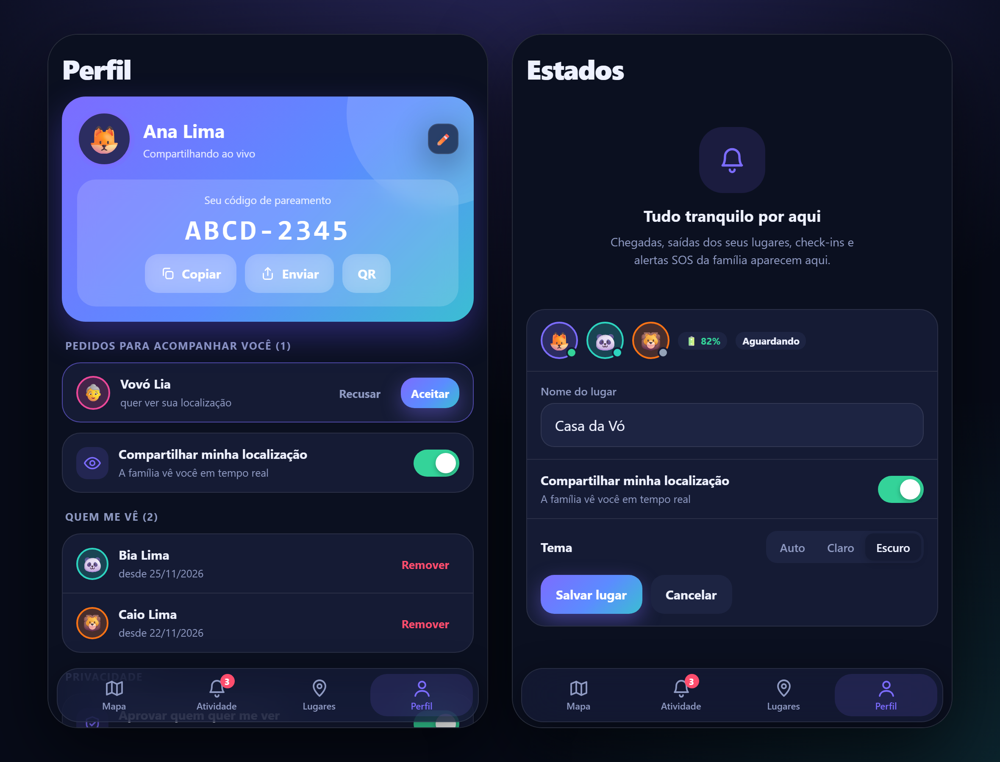
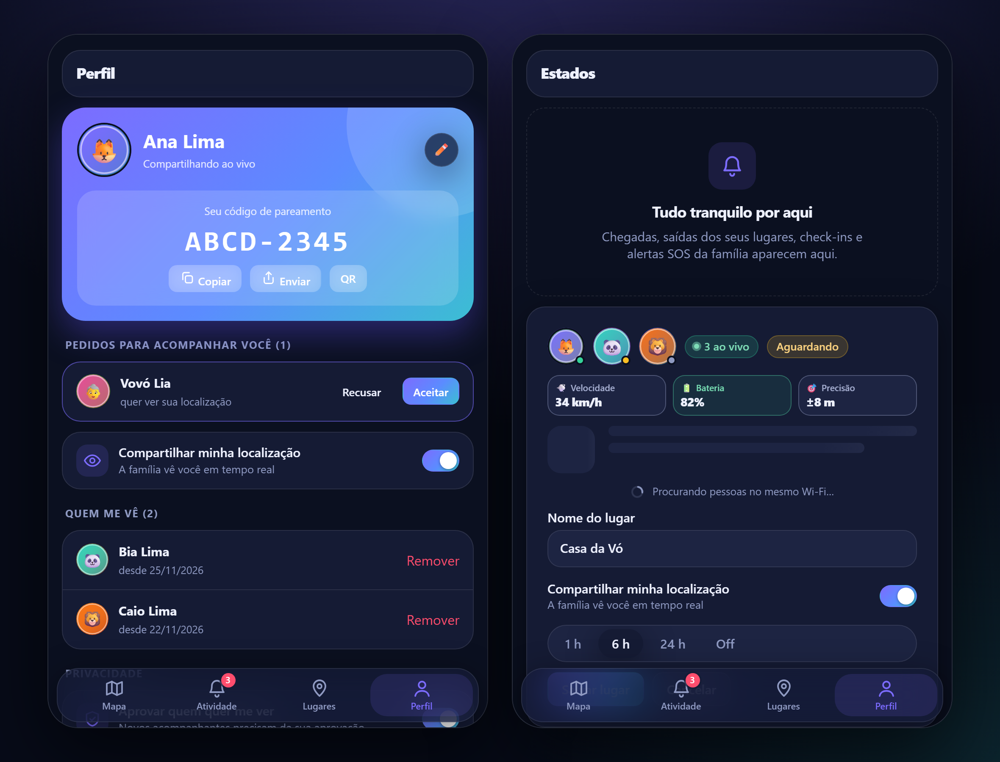

# Migração para `@juninmd/sonido` 2.5.0

O app do Perto trocou os primitivos próprios pelos componentes publicados no
[`@juninmd/sonido`](https://github.com/juninmd/sonido) **2.5.0**, mantendo a identidade
do app (acento violeta `#7c6cff`, cartões arredondados, emoji + cor por pessoa e textos em
pt-BR). Nenhuma cópia local dos componentes genéricos foi criada.





## Componentes trocados

| Componente | Antes (Perto) | Depois (`@juninmd/sonido`) | Arquivos |
| --- | --- | --- | --- |
| `Button` | `<button className="btn primary/soft/ghost/danger">` repetido nas telas | `Button` com `variant`, `size`, `loading` e `iconStart` | `AddPerson`, `Onboarding`, `Nearby`, `Pages`, `MapOverlay`, `Sos` |
| `Badge` | `.badge` da nav e `.chip` de bateria/status | `Badge` (`count`, `soft`, `dot`, `live`) | `App`, `Avatar` (`BatteryChip`), `MapOverlay`, `Nearby` |
| `Avatar` | `span.avatar` com emoji, cor e ponto manual | `Avatar` do Sonido com a imagem do emoji/cores gerada em SVG e o ponto de presença | `Avatar.tsx` (adaptador fino), todas as telas |
| `Dialog` | `Modal` com portal, Esc e sheet próprios | `Dialog` nativo (`showModal`, foco preso, Esc e backdrop) | `Modal.tsx` (adaptador), `AddPerson`, `Pages`, `MapOverlay`, `Qr` |
| `EmptyState` | função `Empty` local | `EmptyState` com ícone, título, descrição e `titleAs` | `Pages` (`Activity`, `Places`) |
| `Skeleton` / `Spinner` | não existiam | `Skeleton rows/media` e `Spinner` (também via `Button loading`) | `Nearby`, `AddPerson`, `Onboarding` |
| `TextField` | `label.field > input` e `.mini-input` | `TextField` com rótulo, dica, erro, `aria-describedby` e modo compacto | `AddPerson`, `Onboarding`, `Pages`, `MapOverlay` |
| `Toast` | `div.toast` controlada por `store.toast` | `ToastProvider` + `useToast`; um host mantém a API `toast()` dos módulos sem React | `main.tsx`, `Toaster.tsx`, `App.tsx` |
| `Tabs` | `.seg` com botões `.on` | `Tabs variant="pill"` com setas/Home/End e ARIA | `AddPerson` (código/Wi‑Fi), `Pages` (tema), `MapOverlay` (trajeto) |
| `Card` | `section.group-card` e `button.card` | `Card` (`surface`, `padding`, `interactive`) como base de layout | `Pages`, `MapOverlay` |
| `Switch` | botão `role="switch"` próprio | `Switch` sobre `input type=checkbox` | `Pages` |
| `ConfirmButton` | botões destrutivos de um passo | `ConfirmButton appearance="inline"` (dois passos, Esc cancela) | `Pages` (remover watcher, revogar convite, apagar conta) |
| `FilterChips` | `.chip-btn` repetido | `FilterChips` | `MapOverlay` (grupos, limite de velocidade, sugestões) |
| `PageHeader` / `StatTile` | `h1.page-title` e `.stat` | `PageHeader` e `StatTile` | `Pages`, `MapOverlay` |

### O que continua local, de propósito

`MapView`, `MapOverlay` (composição do mapa/sheet), `Qr`/`Scanner` e `Sos` dependem do domínio
do Perto (MapLibre, geolocalização, câmera, QR e fluxo de emergência) e não têm equivalente
genérico no Sonido. A navegação inferior continua local porque é um dock de ícones com rótulo
e badge, não um tablist de conteúdo. Os seletores de emoji/cor do onboarding são identidade do
produto, não primitivos genéricos. O controle de atribuição do MapLibre também segue local.

O `Avatar` é o único adaptador de componente: o Sonido modela nome/iniciais e cor derivada do
nome, enquanto o Perto usa **emoji + cor escolhidos pela pessoa**. O adaptador gera um SVG
(`data:image/svg+xml`) com o emoji e a cor e entrega ao `Avatar` do Sonido, que continua dono
de tamanho, anel e ponto de presença. Não há cópia do componente.

## Tema e pontes

`app/src/main.tsx` importa `@juninmd/sonido/styles.css` uma vez, antes de `styles.css`. O
`index.html` nasce com `data-theme="dark"`, e o app escreve `data-theme` em `<html>` conforme a
preferência. O onboarding é uma superfície escura por design, então ele força `data-theme="dark"`
enquanto não há credenciais (evita rótulos claros em fundo escuro quando o sistema está no tema
claro).

`styles.css` mapeia os tokens do Sonido para os tokens do Perto, sem reescrever componentes:

```css
:root, :root[data-theme='light'] {
  --sn-color-accent: var(--brand);       /* #7c6cff */
  --sn-gradient: var(--grad);
  --sn-color-bg: var(--bg);
  --sn-color-surface: var(--solid);
  --sn-color-text: var(--text);
  --sn-color-danger: var(--danger);
  --sn-font: ui-rounded, 'SF Pro Rounded', system-ui, ...;
  /* ... */
}
```

As demais regras adicionadas são só de encaixe: largura das `Tabs` de modo, posição do badge da
nav, botões de ícone sobre o mapa, `Switch` em linha e as células de `StatTile` no sheet.

## Capturas

As duas imagens foram geradas em Chromium, viewport **1180×900 @2x**, página inteira, com dados
fictícios (Ana/Bia/Caio/Vovó Lia, código `ABCD-2345`; nenhuma coordenada real).

- **Antes**: worktree destacado de `origin/master` em
  `C:/Users/jr_ac/AppData/Local/Temp/opencode/before-family-location`, com um harness efêmero
  que importava o CSS real do app e os componentes antigos (`Profile` real + a mesma página de
  estados usando `.btn`, `.field`, `.switch`, `.seg`, `.empty`, `.avatar`, `.chip`). Porta 5337.
- **Depois**: harness efêmero no working tree, renderizando o `Profile` real migrado e a mesma
  página de estados com `PageHeader`, `EmptyState`, `Card`, `Avatar`, `Badge`, `StatTile`,
  `Skeleton`, `Spinner`, `TextField`, `Switch`, `Tabs` e `Button`. Porta 5327.
- Comando: `node C:/Users/jr_ac/AppData/Local/Temp/opencode/shot/full.cjs "<url>" "<png>"`.

Os harnesses (`preview.html`, `src/preview.tsx`, `src/preview.css`) foram apagados antes do
commit. Não existe `docs/sonido-migration/legacy/` nem `preview.*` versionado; este diretório
contém apenas `antes.png`, `depois.png` e este README.

## Comandos e resultados

| Comando | Resultado |
| --- | --- |
| `cd app && npm ci` | ok (0 vulnerabilidades) |
| `cd app && npm run typecheck` | ok, sem erros |
| `cd app && npm test` | **3 arquivos, 9 testes, todos passando** (Vitest 4.1.12 + jsdom) |
| `cd app && npm run build` | ok (`tsc --noEmit` + `vite build`); aviso de chunk > 1200 kB, já existente por causa do MapLibre |
| `cd app && npm audit` | 0 vulnerabilidades |
| `origin/master`: `npm run build` | ok no Windows |
| `origin/master`: `npx tsc --noEmit` | ok no Windows |
| `origin/master`: `npm test` | não existe script nem testes no app antes desta mudança |

Não há falha específica de Windows: os comandos que existiam no `origin/master` passam
igualmente antes e depois. O app não tinha script de lint nem suíte de testes; o typecheck faz
parte do `build` e os testes foram adicionados junto com a migração (nunca pulados).

## Limitações conhecidas

- O CSS do Sonido adiciona ~142 kB ao bundle (96,95 kB → 239,26 kB no build). O JS continua
  dominado pelo MapLibre (~1,45 MB); o aviso de chunk grande é anterior à migração.
- `MapView` e a composição do mapa não foram alterados; o mapa não aparece nas capturas porque o
  harness isola as páginas de perfil/estados.
- O `Toaster` mantém a função `toast(text, kind)` usada por módulos sem React; a conversão para
  `ToastProvider` acontece em um único host.
